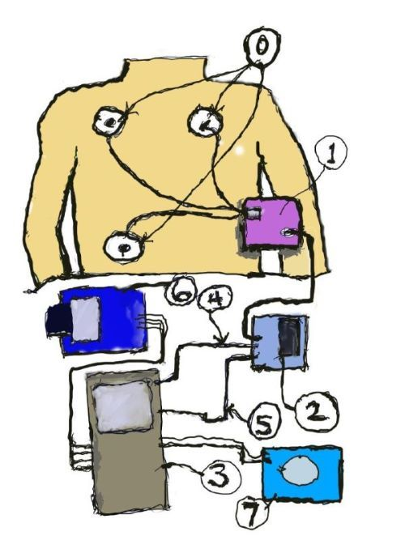
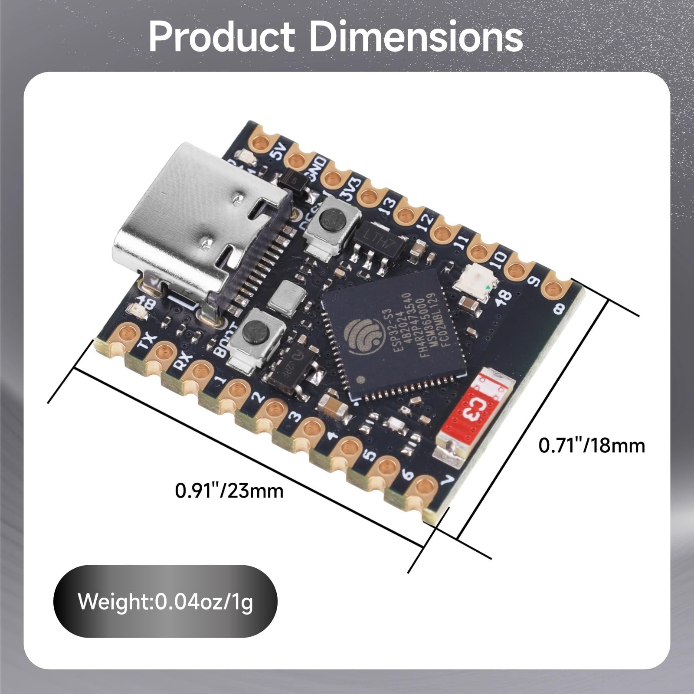
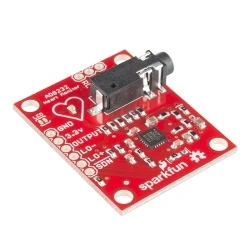
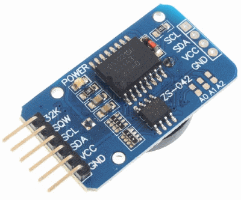
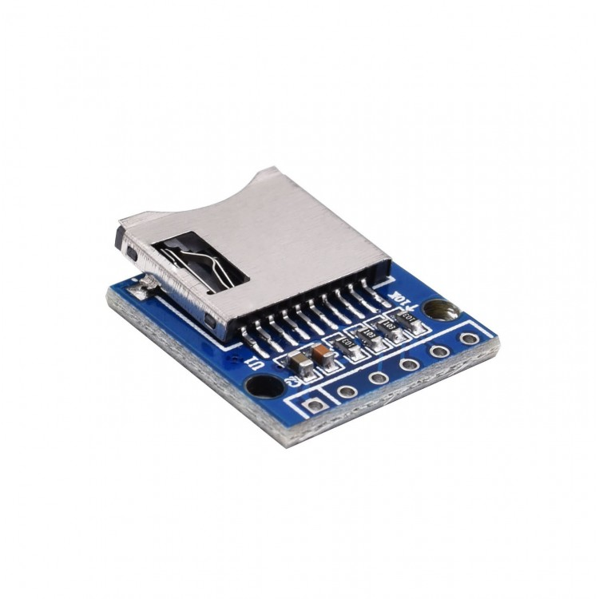
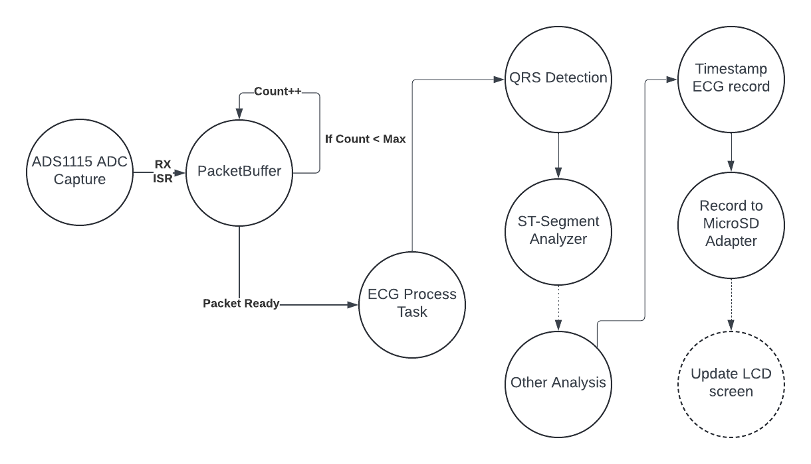

# ESP32-ECGMonitor

[简体中文](./README.zh-CN.md)

* This is a low-cost continuous real-time ECG monitor using Espressif's ESP32 architecture, along with their ESP-IDF framework. The bulk of the code is in C, and it is accessible from a GitHub repository. We are using cheap, off-the-shelf components that are easily acquired.

The following is a very rough sketch of the ECG system. NOTE: the drawing reflects the use of an ESP32-DevKit, but that has since been changed to now use a smaller ESP32 board, the ESP32S3-supermini board.

* 

* A rough sketch to illustrate how the ECG Monitor system works.
    * The electrodes **(0)** are placed on the patient being monitored.
    * The electrode wire bundle is connected to a AD8232 **(1)**, a heart rate front end.
    * The signal data from the AD8232 is attached to the ADS1115 **(2)**, a 16-bit analog-to-digital converter.
    * The digitized data is collected from the I2C serial bus (the wires labeled **(4)** and **(5)**), and processed by the ESP32 DevKit microcontroller **(3)**.
    * The data and analysis is recorded to the MicroSD adapter board **(6)**.
    * The RTC (Real-time clock **(7)**) will add time data that is inserted into the MicroSD adapter **(6)**, thus providing time stamped ECG charting for clinical technicians who are monitoring the data.

* The primary hardware components of the project are:
    - **ESP32 DevKit WROOM-32U**. (Note, I have recently tried the **ESP32S3 supermini board**, which is smaller, and that works well)
        * 
    - **(1) ADS1115 Breakout boards. 16-bit ADC, 4 ADC channels**
        * 
    - **(4 are used for a full 12 electrode setup) AD8232 Physiological Monitor**.
         * 
    - **RTC. Needed for real-time charting updates for time stamping. (DS3231). In addition, the board also has a AT24C32 which will be used as storage for a configuration file**
         * 
    - **MicroSD 8GB Adapter - Recording ECG Traces. (SPI Mode)**
         * 

* The primary software components of the project are:
    * We will be using ESP-IDF, v6.0.2. This will necessitate the use of the I2C_master driver.
    * The ESP-IDF package includes a Real Time Operation System, called FreeRTOS. This provides the framework for orderly handling of the data collection and the various tasks that are undertaken by the microcontroller.
    * The software components for the various devices used by the ECG monitor - the drivers for the ADC chips, the RTC board, the MicroSD adapter.
    * The cardiac data analysis will need to handle QRS detection, which gives the basic heart rate data. The data analysis component may also be expanded to include more features which can be very useful for monitoring patient health.

# Processing flow for ECG signal capture, processing, and storage

* This represents the flow for the ECG signal process.
    * On the far left, there is a ADC Capture component that stores the captured signal into a Packet buffer.
    * When the maximum for the packet size is reached, the ECG Process Task is called.
    * This in turn encompasses QRS Detection, which will be handled by the Pan-Tompkins algorithm, which result in the primary metrics, the QRS duration and the R-R interval.
    * Following that, an ST-segment analyzer is called.
    * There may be one or more algorithms called after that (TBD)
    * The recording of the data follows, with a call to generate a timestamp for the packet trace
    * The data is written to the MicroSD card.
    * Optionally, a LCD screen if present and configured can be updated with the new data as well.

# Additional Documentation

# Component cost estimations
See: COST-ESTIMATES.md

# Personal details
See: PERSONAL-NOTES.md

# Some AI generated notes on the design of the ECG monitor
* [Design Notes](./docs/DESIGN.md) — a high-level overview of the design of the ECG monitor, including the hardware and software architecture, and the interface between the ESP32S3 and the peripheral devices.

* [Power-Supply Noise Guide for Makers](./docs/Power-Supply-Noise-Guide.md) — how to diagnose and fix 60 Hz mains hum vs. switching-regulator noise in this design (battery power, grounding, decoupling, and LC filters).
* [How to Make CMakeLists.txt](./docs/HOW-TO-MAKE-CMAKELISTS.md) — a project-specific tutorial on the ESP-IDF build system, `idf_component_register()`, and adding a new component.
* [Unipolar 12-Lead ECG Design Notes](./docs/UNIPOLAR-12-LEAD.md) — corrected notes on extending the system to a standard 12-lead ECG (Wilson's Central Terminal, 8×AD8232 + 4×ADS1115 wiring, lead derivation, and ISHNE output).

# To restart the Jupyter Book:

# 1. Activate your Python virtual environment
source ../venv/bin/activate

# 2. Spin up the local development preview server
jupyter book start .

# Launch the book: http://localhost:3000/
