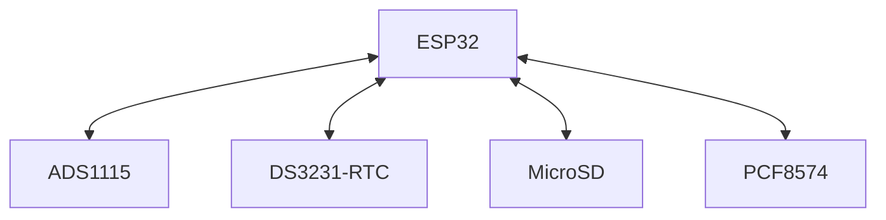
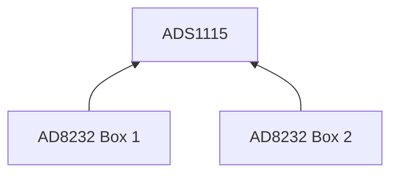

# System Design & Architecture Document: 24/7 ECG Monitor
Caveats: This is a very, very rough draft. Template was designed by Google AI, 2026-10-12

## 1. Document Control & Compliance Overview
* **Project Name:** ESP32-ECGMonitor
* **Target Hardware:** Espressif ESP32 S3 WROOM / WROVER Module
* **Development Framework:** Espressif ESP-IDF (v5.x) with native FreeRTOS
* **IEC 62304 Software Safety Classification:** **Class B / Class C** (Potential for delayed or missed cardiac arrhythmia detection)

---

## 2. System Architecture & Block Diagram
The system follows a hardware-software co-design model splitting medical-critical data acquisition from non-critical logging and storage utilities using the dual-core architecture of the ESP32.

### 2.1 Hardware Block Diagram
# The main control block
From a top-level perspective, there are 5 electronic devices. There is a ESP32 microcontroller and 4 peripheral components. Each peripheral device has some form of bi-directional communication, represented by a double ended arrow:

# The interface between the ADC chip and the Heart Monitor boards
The ADC chipset ADS1115 interfaces between the ESP32 and two Heart Monitor boards, AD8232

