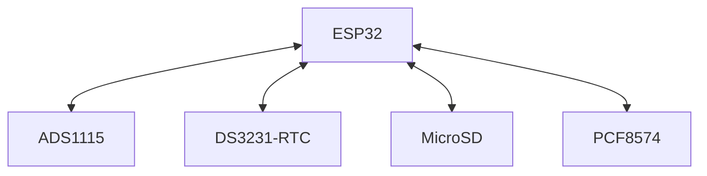
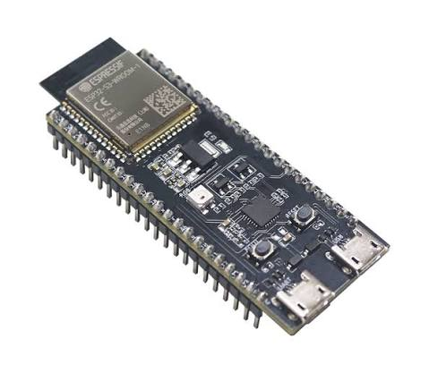
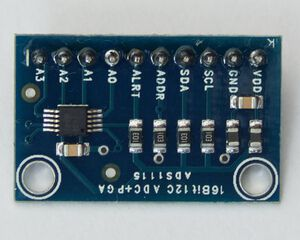
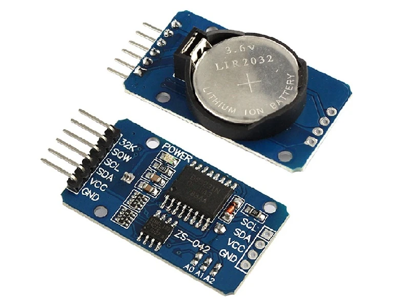
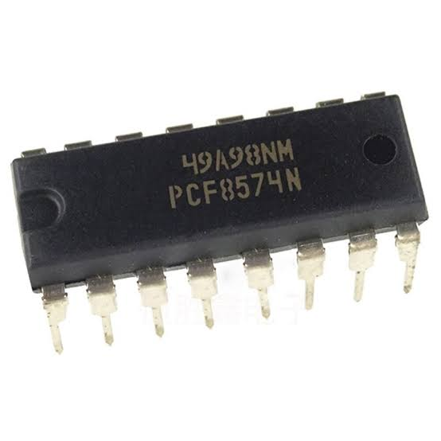
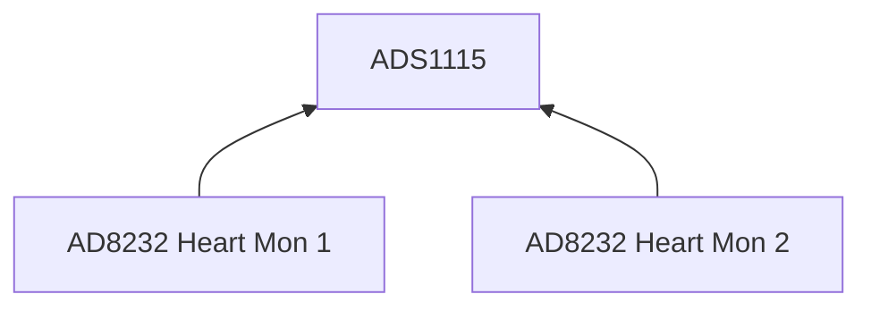
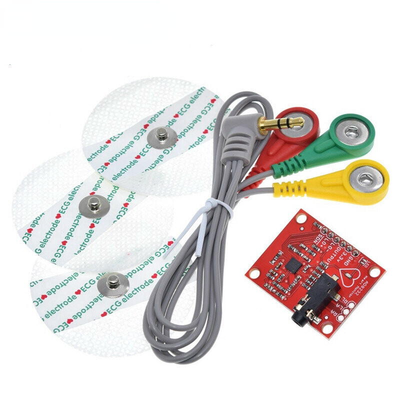

# System Design & Architecture Document: 24/7 ECG Monitor
Caveats: This is a very, very rough draft. Template was designed by Google AI, 2026-10-12

## 1. Document Control & Compliance Overview
* **Project Name:** ESP32-ECGMonitor
* **Target Hardware:** Espressif ESP32 S3 WROOM / WROVER Module
* **Development Framework:** Espressif ESP-IDF (v5.x) with native FreeRTOS
* **IEC 62304 Software Safety Classification:** **Class B / Class C** (Potential for delayed or missed cardiac arrhythmia detection)

---

## 2. System Architecture & Block Diagram
The system follows a hardware-software co-design model splitting medical-critical data acquisition from non-critical logging and storage utilities using the dual-core architecture of the ESP32.

### 2.1 Hardware Block Diagram

NOTE: There is a battery pack supply that powers the chipset. The pack is composed of 18650 Li-ON batteries, a DC boost converter, the MT3608, and it delivers 5V to power the ESP32. The ESP32 will generate a 3.3V for the peripheral devices. Details on the battery pack supply TBD

#### 2.1.1 The main control block
From a top-level perspective, there are 5 principle devices. There is a ESP32 microcontroller and 4 peripheral components. Each peripheral device has some form of bi-directional communication, represented by a double ended arrow:

The devices, ADS1115, DS3231, MicroSD adapter, and GPIO extender use serial bus protocols for transmitting and receiving commands and data. 
* The ADS1115, DS3231, and PCF8574 all communicate over I2C
* The MicroSD adapter uses SPI

For the basic prototype, i.e., Proof of Concept, we will use commonly available breakout boards. A release version will of course have a PCB with mostly SMD parts. The basic prototype uses the breakout boards.

The ESP32 uses certain GPIO pins for handling I2C, and another set of GPIO pins for handling SPI. There are 2 versions that are being used, the ESP32S3 super mini board, and the ESP32-S3-WROOM:
* ESP32S3 super mini board: 
* ESP32-S3-WROOM DevKit: 

The ADS1115 is a 16-bit 4-channel ADC module
* The ADS1115 board :  

The DS3231 RTC breakout board contains the RTC chip, an I2C EEPROM, and a coin battery:
* The DS3231 board  :  

The MicroSD breakout board allows the system to create & write the ECG trace data.
* The MicroSD board :  

The GPIO Extender chip, the PCF8574, is a 16-pin DIP package. It is needed for handling the Leads Off indicators that are generated by the SD8232 if the chip senses that an ECG lead has fallen off from the patient's torso.
* The PCF8574 board :  

#### Interface documents between the ESP32S3 and the peripheral chips
Further details on the design of the interface between the ESP32S3 and the peripheral devices TBD
* The ESP32S3 interface with the ADS1115. TBD
* The ESP32S3 interface with the DS3231. TBD
* The ESP32S3 interface with the MicroSD board. TBD
* The ESP32S3 interface with the PCF8574. TBD

#### 2.1.2 The interface between the ADC chip and the Heart Monitor boards
The ADC chipset ADS1115 interfaces between the ESP32 and two Heart Monitor boards, AD8232

The AD8232 heart monitor boards will drive an analog output (labeled OUT), that is connected to the correct Ax pin on the ADS1115. It is this analog output signal that is digitized by the ADC chip. When the ADC capture is ready to be processed by the CPU, the ADS1115 drives the ALRT pin that signals the ESP32 to fetch a new sample via I2C.

Each AD8232 has a electrode jack, where a set of biomed electrodes get the ECG signal via pads that are attached to the patient.

* The AD8232 with electrodes : 
