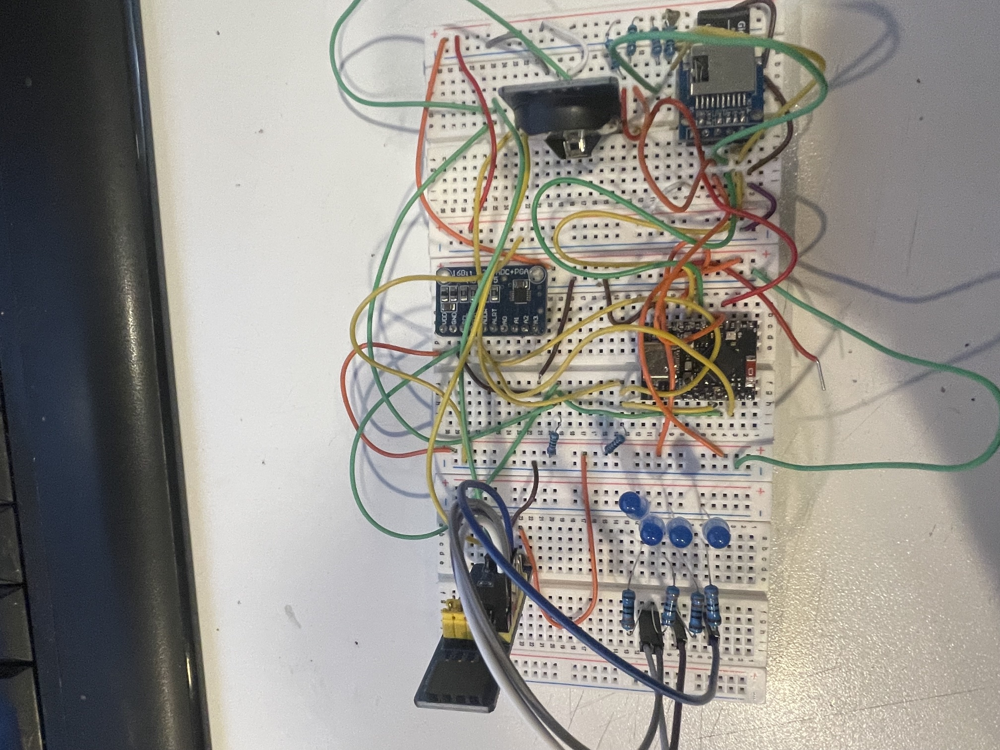
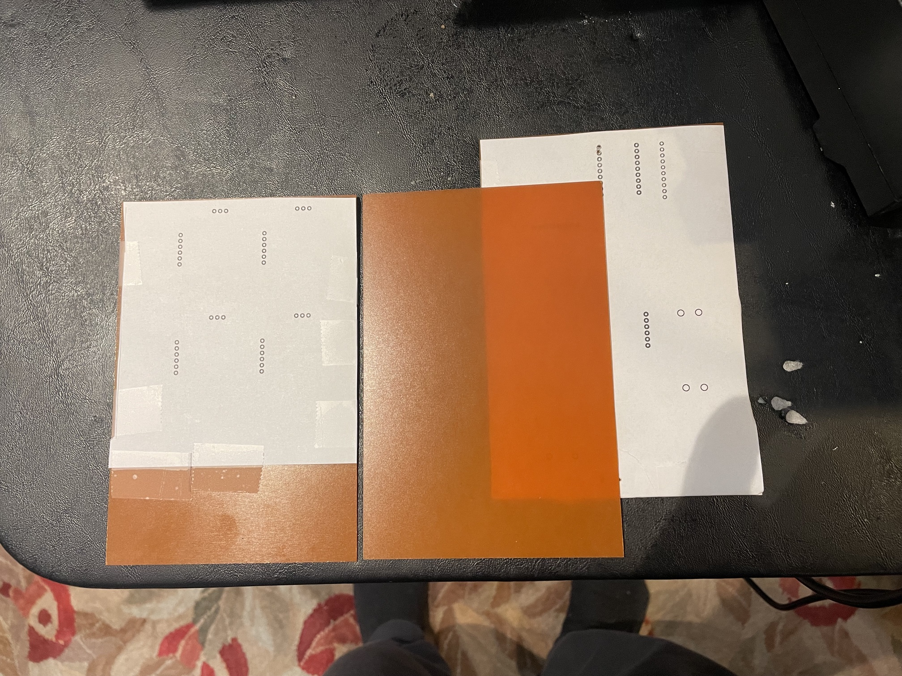
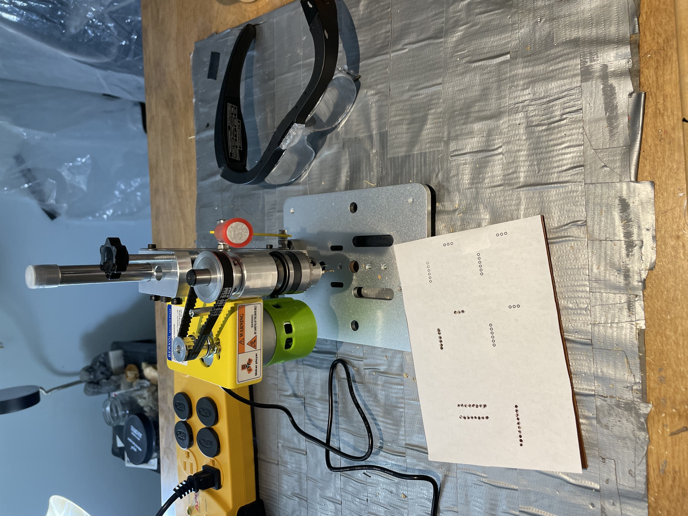

# Quick and Dirty way to place electronic components on a board 
Breadboards are great for very basic electronic setups, and allow and enable the developer to flesh out and test the design.
* 

The drawback with breadboards is that they are clunky, and while it will hold in place the small boards, it is very hard to incorporate breadboards into a convenient portable package. Additionally, connections on the breadboard can introduce unwanted parasitic capicitance that can accumulate and can contribute to less-than-desired circuit performance. And by populating the breadboard with chips and the jumper wires, you can easily end up with something that resembles a rat's nest.

Normally the next step after the breadboard layout and testing would normally be the development and production of a printed circuit board, which can be quite involved and often error prone.

Luckily, I came across a very handy intermediate step that involves the use of phenolic plates for mounting the small boards, and by using a mini drill press, which allows for easy insertion of the boards by drilling holes for the board pins.

Here are some **Phenolic plates** 
* 
As mentioned, we need to use a mini drill press to drill holes into the plates to accomodate the various small boards
**Mini-drill press with phenolic plate**
* 

Above, we see a phenolic plate with a paper drill outine (made with Fritzing) taped to it on the mini drill. Since I do not have an automated CNC machine, this is the best way to guide the drill in a manual process.